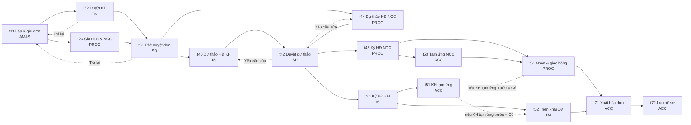

# Quy trình xử lý đơn hàng & SLA

**Nguồn:** *Đặc tả chức năng hệ thống – TeraBox Hiệu quả đơn hàng (P&L)*. Các phần được dùng:

- Module 6: Quy trình xử lý đơn hàng & SLA;
- mục 4.6: Quy trình, phê duyệt và SLA;
- mục 2.3: Các nhóm người dùng;
- mục 2.5: Ma trận phân quyền;
- NFR-12: Thông báo.

---

## 0. Quy ước

### 0.1 Vai trò

| Mã | Vai trò | Trách nhiệm trong quy trình |
|---|---|---|
| AM | Account Manager · Nhân viên Sale | Lập đơn, Phiếu khảo sát, Danh mục, giá bán / giá mua dự kiến; gửi duyệt |
| IS | Inside Sale | Lập đơn thay AM; soạn dự thảo và trình ký HĐ khách hàng; cập nhật Số HĐ/PO; Close-lost |
| TM | Technical Manager | Duyệt giải pháp và chi phí kỹ thuật; triển khai và nghiệm thu |
| SD | Sales Director | Phê duyệt đơn và phương án mua hàng; duyệt dự thảo HĐ; ký HĐ (ký HĐ NCC đồng thời là duyệt tạm ứng NCC) |
| PROC | Procurement · Mua hàng | Đề xuất giá mua và NCC; dự thảo và ký HĐ NCC; nhận hàng và giao cho KH |
| ACC | Sales Accountant · Kế toán | Xác nhận KH tạm ứng; thanh toán tạm ứng NCC; xuất hóa đơn; lưu hồ sơ |
| Admin | Quản trị viên | Cấu hình SLA, ngưỡng và nhân sự. Không xử lý task |

AI không phải một vai trò riêng. AI là trợ lý gắn vào từng task và chỉ đưa ra gợi ý; người phụ trách task vẫn là người quyết định.

### 0.2 Loại thao tác

| Loại | Nút | Ghi chú |
|---|---|---|
| Gửi duyệt | Gửi duyệt | Chỉ có ở t11 |
| Duyệt | Duyệt / Trả lại | t22, t31. Trả lại bắt buộc ghi lý do |
| Duyệt dự thảo | Đồng ý trình ký / Yêu cầu sửa dự thảo | t42. Yêu cầu sửa bắt buộc ghi chú |
| Hoàn thành | Hoàn thành | Các task còn lại |
| Tùy chọn | Hoàn thành / Không áp dụng | t51, t53 |

Chỉ vai trò phụ trách mới thấy nút thao tác (FR-6.2).

### 0.3 Nguyên tắc chuyển bước

1. **Mở theo tiền đề.** Mỗi task mở ngay khi mọi task tiền đề của nó đã xong, đã bị bỏ qua hoặc được bấm "Không áp dụng". Task không chờ cả giai đoạn (BR-41).
2. **Tự bỏ qua.** Task không áp dụng cho nội dung đơn được hệ thống đánh dấu "Bỏ qua" ngay, không cần ai bấm. Task bị bỏ qua được tính là đã xong.
3. **Tính lại điều kiện.** Điều kiện bỏ qua được tính lại mỗi khi dữ liệu đơn thay đổi. Ví dụ: thêm dòng thiết bị thì t23, t44, t45, t53, t61 tự mở lại.
4. **Cổng OR hợp nhánh.** Cổng hợp nhánh chỉ chờ những nhánh đã được kích hoạt.
5. **Thanh 7 giai đoạn chỉ để theo dõi.**
   - Giai đoạn hiện tại là giai đoạn đầu tiên còn task chưa xong.
   - Giai đoạn có task đang chạy trước thời điểm của nó hiển thị nhãn "Song song".
   - Khi một giai đoạn xong, hệ thống ghi "Hoàn tất GĐn" vào lịch sử.
   - Đơn được coi là "đã phê duyệt" khi xong GĐ1–3 (BR-4B).
6. **Quyền sửa dữ liệu đơn** chỉ mở ở GĐ1 hoặc khi đơn bị trả lại.

---

## 1. Task áp dụng theo nội dung đơn

Quy trình **không phân nhánh theo loại deal**. Task được bật hoặc tắt theo **các dòng trong Danh mục** (BR-40).

| Nội dung đơn | Task áp dụng |
|---|---|
| Có dòng dịch vụ (DVTK-*, DVDK-*, …) | t22, t62 |
| Có dòng Thiết bị / License (TB, LIC, LIC-DK, LIC-NTNN) | t23, t44, t45, t53, t61 |
| Mọi đơn | t11, t40, t42, t41, t51, t71, t72 |
| Đơn > 300 triệu, **hoặc** có mua hàng, **hoặc** chưa đạt ngưỡng LN | t31 do SD duyệt |
| Đơn ≤ 300 triệu, không có TB / license **và** đạt ngưỡng LN | t31 **tự duyệt** |

Từ đó có 3 dạng luồng:

| Dạng đơn | Task chạy |
|---|---|
| Chỉ dịch vụ | t11 → t22 → t31 → t40 → t42 → t41 → t51 ∥ t62 → t71 → t72 |
| Chỉ TB / license | t11 → t23 → t31 → t40 ∥ t44 → t42 → t41 ∥ t45 → t51, t53 → t61 → t71 → t72 |
| Hỗn hợp | Cả hai nhánh chạy song song, hợp lại ở t31, t42 và t71 |

---

## 2. Sơ đồ phụ thuộc task

Bảng tiền đề tương ứng `TASK_REQ` trong mockup:

| Task | Tiền đề |
|---|---|
| t22, t23 | t11 |
| t31 | t22, t23 |
| t40, t44 | t31 |
| t42 | t40, t44 |
| t41, t45 | t42 |
| t51 | t41 |
| t53 | t45 |
| t61 | t45, t53 (+ t51 nếu "KH tạm ứng trước khi giao / triển khai" = Có) |
| t62 | t41 (+ t51 nếu "KH tạm ứng trước khi giao / triển khai" = Có) |
| t71 | t61, t62 |
| t72 | t71 |

---

## 3. Chi tiết 7 giai đoạn · 15 task

### GĐ1 — Khởi tạo

#### t11 · Lập đơn hàng & gửi duyệt

| | |
|---|---|
| Vai trò | AM (IS lập thay được) |
| Loại | Gửi duyệt |
| SLA | 1 ngày, tính từ ngày tạo đơn hoặc lần bị trả lại gần nhất |
| Mở khi | Tạo đơn; hoặc đơn bị trả lại từ t22 / t31 |
| Tự bỏ qua | Không |
| Đầu ra | Đơn được gửi duyệt |
| AI | Tự điền thông tin KH từ CRM / email báo giá. Gợi ý loại hàng và NCC theo đơn tương tự. Kiểm tra trường thiếu. Cảnh báo LN thuần dưới ngưỡng trước khi gửi |

**Điều kiện hoàn thành** (hệ thống chặn nút khi chưa đủ):

- Thông tin KH đủ các trường: Tên, Mã KH, MST (đúng định dạng, đang hoạt động), Người liên hệ.
- Phiếu khảo sát đủ trường bắt buộc, gồm phân bổ giai đoạn deal 13/–18/: mỗi giai đoạn có người phụ trách và tỷ lệ, tổng tỷ lệ = 100%.
- Danh mục có ít nhất 1 dòng. Mỗi dòng đủ trường bắt buộc; dòng TB / LIC phải có P/N.
- Không còn lỗi định dạng (BR-42).
- Nếu có cảnh báo nghiêm trọng (P&L dưới ngưỡng, MST đã đóng): bắt buộc ghi lý do. Lý do được lưu vào nhật ký "Bỏ qua cảnh báo".

**Rẽ nhánh khi gửi duyệt:** mở t22 nếu đơn có dòng dịch vụ, mở t23 nếu đơn có TB / license.

### GĐ2 — Thẩm định

#### t22 · Duyệt giải pháp & chi phí kỹ thuật

| | |
|---|---|
| Vai trò | TM |
| Loại | Duyệt / Trả lại |
| SLA | 1 |
| Mở khi | t11 xong |
| Tự bỏ qua | Đơn không có dòng dịch vụ |
| Nội dung | Đánh giá giải pháp, nhân sự triển khai, chi phí hỗ trợ kỹ thuật |
| Hoàn thành | Duyệt; hoặc Trả lại (bắt buộc lý do) |
| Quay lại | Trả lại → đơn về t11, xóa trạng thái các task đã làm |
| Đầu ra | Phương án kỹ thuật được duyệt |
| AI | So cấu hình với Phiếu khảo sát và đơn tương tự để phát hiện hạng mục thiếu (license, vật tư, nhân công). Ước tính man-day |

#### t23 · Đề xuất giá mua & nhà cung cấp

| | |
|---|---|
| Vai trò | PROC |
| Loại | Hoàn thành |
| SLA | 1 |
| Mở khi | t11 xong, chạy song song với t22 |
| Tự bỏ qua | Đơn không có TB / license |
| Nội dung | Nhập đơn giá mua đề xuất và chọn NCC ở tab Đơn mua hàng |
| Hoàn thành | Mọi dòng TB / license có đơn giá mua đề xuất. Dòng có giá cao hơn giá Sale đề xuất bắt buộc ghi lý do |
| Đầu ra | Phương án mua hàng |
| AI | Tra giá mua lịch sử và bảng giá NCC. Xếp hạng 2–3 NCC theo giá, thời gian giao, công nợ. Soạn sẵn email hỏi giá |

### GĐ3 — Phê duyệt

#### t31 · Phê duyệt đơn & phương án mua hàng

| | |
|---|---|
| Vai trò | SD |
| Loại | Duyệt / Trả lại |
| SLA | 1 |
| Mở khi | t22 và t23 xong (cổng OR hợp nhánh) |
| Tự duyệt | Đơn ≤ 300 triệu, không có TB / license **và** đạt ngưỡng LN |
| Nội dung | Duyệt chi phí (P&L) và phương án mua hàng |
| Quay lại | Trả lại → đơn về t11 |
| Đầu ra | Đơn được phê duyệt. Bộ tham số P&L được chốt tại thời điểm này |
| AI | Tóm tắt đơn và chấm điểm rủi ro (LN thuần, công nợ, KH mới, chênh giá mua). So với đơn tương tự. Gợi ý Duyệt / Trả lại kèm lý do |

**Điều kiện hoàn thành:** Duyệt hoặc Trả lại. Bắt buộc ghi lý do khi SD vẫn duyệt trong các trường hợp:

- P&L không đạt ngưỡng LN;
- AI khuyến nghị "Trả lại".

### GĐ4 — Hợp đồng

Giai đoạn này tách làm 2 bước: **dự thảo** (SD duyệt nội dung trước) rồi mới đến **bản chính thức** đã ký. Hợp đồng KH hoặc NCC có giá trị **> 20 triệu** bắt buộc có file ở cả hai bước (BR-44).

#### t40 · Dự thảo HĐ khách hàng

| | |
|---|---|
| Vai trò | IS |
| Loại | Hoàn thành |
| SLA | 2 |
| Mở khi | t31 xong hoặc tự duyệt |
| Tự bỏ qua | Không |
| Nội dung | Soạn dự thảo bằng AI hoặc upload bản KH gửi. AI kiểm tra và rà soát điều khoản để trình SD |
| Đầu ra | Bản dự thảo HĐ KH kèm khuyến nghị của AI |

**Điều kiện hoàn thành:**

- Có dự thảo (bắt buộc file khi > 20 triệu).
- AI kiểm tra không còn lỗi, hoặc lỗi đã được xác nhận kèm lý do.
- Đã chạy AI rà soát điều khoản. AI kết luận một trong ba mức: Đồng ý ký / Ký, có lưu ý / Chưa nên ký.

#### t44 · Dự thảo HĐ nhà cung cấp

| | |
|---|---|
| Vai trò | PROC |
| Loại | Hoàn thành |
| SLA | 1 |
| Mở khi | t31 xong hoặc tự duyệt, chạy song song với t40 |
| Tự bỏ qua | Đơn không có TB / license |
| Nội dung | Soạn dự thảo HĐ từng NCC theo giá mua đã duyệt và lịch tạm ứng |
| Hoàn thành | Mỗi NCC > 20 triệu có dự thảo. AI kiểm tra sạch hoặc lỗi đã được xác nhận |
| Đầu ra | Bản dự thảo HĐ từng NCC, kèm lịch tạm ứng |

#### t42 · Duyệt dự thảo hợp đồng

| | |
|---|---|
| Vai trò | SD |
| Loại | Đồng ý trình ký / Yêu cầu sửa dự thảo |
| SLA | 1 |
| Mở khi | t40 và t44 xong |
| Tự bỏ qua | Không |
| Nội dung | Đọc dự thảo HĐ KH, HĐ NCC và khuyến nghị của AI |
| Hoàn thành | Đồng ý trình ký. Nếu AI kết luận "Chưa nên ký" thì bắt buộc ghi lý do |
| Quay lại | Yêu cầu sửa (bắt buộc ghi chú) → mở lại t40 / t44, **không** trả đơn về t11 |
| Đầu ra | Dự thảo được duyệt để trình ký |
| AI | Tóm tắt hai dự thảo và các điểm lệch so với P&L |

#### t41 · Ký HĐ khách hàng · bản chính thức

| | |
|---|---|
| Vai trò | IS |
| Loại | Hoàn thành |
| SLA | 3 |
| Mở khi | t42 đồng ý |
| Tự bỏ qua | Không |
| Nội dung | Trình SD ký bản dự thảo đã duyệt, gửi KH ký, upload bản chính thức có đủ chữ ký và dấu |
| Đầu ra | HĐ KH đủ chữ ký, khớp dự thảo, có Số HĐ/PO |
| AI | Kiểm tra chữ ký và con dấu. So khớp với dự thảo. Tự điền Số HĐ/PO, ngày ký, công nợ, thông tin giao nhận |

**Điều kiện hoàn thành** (BR-45):

- Bản chính thức khớp dự thảo đã duyệt, hoặc phần lệch đã được xác nhận. Lệch về giá trị, bên ký hoặc điều khoản thanh toán là **lỗi chặn**.
- Đủ các trường: Số HĐ/PO, số lần thanh toán, địa chỉ KH, thông tin giao nhận (đơn có TB).
- Bắt buộc có file khi giá trị > 20 triệu.

**Ràng buộc:** đây là mốc cuối cùng được phép Close-lost. Sau khi t41 xong thì không Close-lost được nữa.

#### t45 · Ký HĐ nhà cung cấp · bản chính thức

| | |
|---|---|
| Vai trò | PROC |
| Loại | Hoàn thành |
| SLA | 2 |
| Mở khi | t42 đồng ý, chạy song song với t41 |
| Tự bỏ qua | Đơn không có TB / license |
| Nội dung | Gửi NCC ký bản dự thảo đã duyệt, upload bản chính thức |
| Hoàn thành | Bản chính thức của từng NCC > 20 triệu khớp dự thảo, hoặc phần lệch đã được xác nhận |
| Đầu ra | HĐ NCC đủ chữ ký, khớp dự thảo |

**Quy tắc (BR-46):**

- SD ký HĐ NCC (có lịch tạm ứng) đồng thời là **duyệt tạm ứng NCC**.
- HĐ NCC chỉ có hiệu lực khi HĐ KH đã ký, trừ khi SD cho phép đặt hàng sớm.
- Nếu sửa nội dung sau khi dự thảo đã được duyệt thì phải gửi lại dự thảo.

### GĐ5 — Tạm ứng

#### t51 · Xác nhận khách hàng tạm ứng

| | |
|---|---|
| Vai trò | ACC |
| Loại | Hoàn thành / Không áp dụng |
| SLA | 3 |
| Mở khi | t41 xong |
| Tự bỏ qua | Không. ACC tự bấm "Không áp dụng" khi KH không tạm ứng |
| Nội dung | Đối soát khoản tạm ứng của KH |
| Đầu ra | Tạm ứng được xác nhận |
| AI | Đối soát sao kê ngân hàng với giá trị tạm ứng trong HĐ KH |

#### t53 · Thanh toán tạm ứng nhà cung cấp

| | |
|---|---|
| Vai trò | ACC |
| Loại | Hoàn thành / Không áp dụng |
| SLA | 2 |
| Mở khi | t45 xong |
| Tự bỏ qua | Đơn không có TB / license |
| Nội dung | Chuyển khoản tạm ứng NCC theo lịch trong HĐ NCC đã ký. Bấm "Không áp dụng" nếu NCC không yêu cầu tạm ứng |
| Đầu ra | Chứng từ thanh toán |
| AI | Tạo sẵn đề nghị thanh toán / lệnh chuyển tiền từ HĐ NCC |

**Cảnh báo dòng tiền** (BR-48, FR-6.8):

- Task hiển thị số tiền tạm ứng NCC và trạng thái KH tạm ứng.
- Tiền tạm ứng NCC = giá vốn theo từng NCC × tỷ lệ tạm ứng của NCC đó.
- Nếu trả NCC trước khi KH tạm ứng, hệ thống cảnh báo và ghi vào lịch sử.

### GĐ6 — Giao hàng & Triển khai

Mặc định, giao hàng và triển khai **không chờ KH tạm ứng** (BR-47). Ngoại lệ: Phiếu khảo sát chọn "KH tạm ứng trước khi giao / triển khai = Có" thì t61 và t62 chờ thêm t51.

#### t61 · Nhận hàng & giao hàng cho khách hàng

| | |
|---|---|
| Vai trò | PROC |
| Loại | Hoàn thành |
| SLA | 7 |
| Mở khi | t45 và t53 xong (+ t51 nếu áp dụng ngoại lệ) |
| Tự bỏ qua | Đơn không có TB / license |
| Nội dung | Nhận hàng từ NCC, giao cho KH, chuyển chứng từ cho ACC |
| Hoàn thành | Có biên bản giao nhận |
| Đầu ra | Biên bản giao nhận |
| AI | Nhắc lịch giao. OCR biên bản giao nhận, đối chiếu số lượng / serial với Danh mục |

#### t62 · Triển khai & nghiệm thu kỹ thuật

| | |
|---|---|
| Vai trò | TM |
| Loại | Hoàn thành |
| SLA | 7 |
| Mở khi | t41 xong (+ t51 nếu áp dụng ngoại lệ). Chạy song song với t51, t53, t61 |
| Tự bỏ qua | Đơn không có dòng dịch vụ |
| Nội dung | Triển khai dịch vụ, nghiệm thu với KH, chuyển chứng từ cho ACC |
| Hoàn thành | Có biên bản nghiệm thu |
| Đầu ra | Biên bản nghiệm thu |
| AI | Tạo checklist triển khai và nghiệm thu theo loại dịch vụ. Đọc biên bản nghiệm thu |

### GĐ7 — Hóa đơn & Đóng đơn

#### t71 · Kiểm tra biên bản, xuất hóa đơn & gửi hồ sơ thanh toán

| | |
|---|---|
| Vai trò | ACC |
| Loại | Hoàn thành |
| SLA | 2 |
| Mở khi | t61 và t62 xong (cổng OR hợp nhánh) |
| Tự bỏ qua | Không |
| Nội dung | Kiểm tra biên bản giao nhận / nghiệm thu, xuất hóa đơn GTGT, gửi bộ hồ sơ thanh toán cho KH |
| Đầu ra | Hóa đơn đã phát hành |
| AI | Đối chiếu biên bản với HĐ và P&L. Tạo dữ liệu hóa đơn điện tử. Soạn email gửi hồ sơ |

#### t72 · Lưu trữ hồ sơ & cập nhật chi phí phát sinh

| | |
|---|---|
| Vai trò | ACC |
| Loại | Hoàn thành |
| SLA | 1 |
| Mở khi | t71 xong |
| Tự bỏ qua | Không |
| Nội dung | Lưu bản cứng, scan lưu bản mềm, cập nhật chi phí phát sinh (nếu có) vào P&L |
| Kết thúc | Đơn chuyển sang trạng thái **Hoàn tất** và được tính vào KPI |
| AI | Tự đặt tên và lưu file. Trích chi phí phát sinh từ chứng từ. So LN thuần thực tế với kế hoạch |

---

## 4. Phê duyệt, quay lại và đóng đơn

| Cơ chế | Ai | Khi nào | Kết quả |
|---|---|---|---|
| Trả lại | TM (t22), SD (t31) | Khi đang duyệt | Đơn về GĐ1 (t11), mở lại quyền sửa cho AM / IS. Bắt buộc ghi lý do (BR-43, FR-6.3) |
| Yêu cầu sửa dự thảo | SD (t42) | Khi duyệt dự thảo | Mở lại t40 / t44, không về GĐ1. Bắt buộc ghi chú |
| Tự duyệt | Hệ thống (t31) | Đơn ≤ 300 triệu, không mua hàng, đạt ngưỡng LN | Bỏ qua SD |
| Close-lost | IS | Bất kỳ lúc nào **trước khi t41 xong** | Dừng quy trình. Đơn bị loại khỏi doanh thu, KPI và số dự kiến (BR-4A) |
| Hoàn tất | Hệ thống | t72 xong | Đơn tính vào doanh thu và KPI |

**Nhật ký cảnh báo bị bỏ qua** (BR-4C, FR-6.10):

- Mọi cảnh báo của AI hoặc hệ thống mà người dùng vẫn tiếp tục đều được ghi lịch sử. Không sửa hay xóa được.
- Cảnh báo mức **nghiêm trọng** bắt buộc ghi lý do. Cảnh báo mức **lưu ý** được ghi tự động.
- Hoàn thành task quá hạn SLA cũng được ghi vào nhật ký này.

---

## 5. SLA

### 5.1 Quy tắc (BR-49, FR-6.6)

- **Hạn** = thời điểm task mở (task tiền đề cuối cùng xong) + số ngày làm việc. Ngày làm việc là Thứ 2 – Thứ 6.
- Riêng t11: tính từ ngày tạo đơn hoặc lần bị trả lại gần nhất.
- **Trạng thái:** Còn hạn → Sắp đến hạn (còn dưới 24 giờ) → Quá hạn. Task xong được ghi "đúng hạn" hoặc "trễ N ngày".
- SLA = 0 nghĩa là không theo dõi hạn cho task đó.
- Admin cấu hình số ngày SLA cho từng task.
- **Thông báo** (NFR-12): báo cho người phụ trách khi có task mới, khi task sắp hoặc đã quá hạn, và khi đơn bị trả lại. Kênh thông báo: trong ứng dụng và email.
- Dashboard có cảnh báo đơn có task quá hạn. Menu hiển thị huy hiệu số task đang chờ vai trò hiện tại.

### 5.2 SLA mặc định

| GĐ | Task | Vai trò | SLA (ngày làm việc) |
|---|---|---|---|
| 1 | t11 Lập đơn hàng & gửi duyệt | AM / IS | 1 |
| 2 | t22 Duyệt giải pháp & chi phí KT | TM | 1 |
| 2 | t23 Đề xuất giá mua & NCC | PROC | 1 |
| 3 | t31 Phê duyệt đơn & phương án mua hàng | SD | 1 |
| 4 | t40 Dự thảo HĐ KH | IS | 2 |
| 4 | t44 Dự thảo HĐ NCC | PROC | 1 |
| 4 | t42 Duyệt dự thảo HĐ | SD | 1 |
| 4 | t41 Ký HĐ KH · chính thức | IS | 3 |
| 4 | t45 Ký HĐ NCC · chính thức | PROC | 2 |
| 5 | t51 Xác nhận KH tạm ứng | ACC | 3 |
| 5 | t53 Thanh toán tạm ứng NCC | ACC | 2 |
| 6 | t61 Nhận & giao hàng | PROC | 7 |
| 6 | t62 Triển khai & nghiệm thu | TM | 7 |
| 7 | t71 Xuất hóa đơn & gửi hồ sơ | ACC | 2 |
| 7 | t72 Lưu hồ sơ & cập nhật chi phí | ACC | 1 |

### 5.3 Thời gian tối thiểu của một đơn (đường găng)

| Dạng đơn | Đường găng | Tổng |
|---|---|---|
| Chỉ dịch vụ | t11 1 + t22 1 + t31 1 + t40 2 + t42 1 + t41 3 + t62 7 + t71 2 + t72 1 | **19 ngày** |
| Có TB / license | t11 1 + t23 1 + t31 1 + t40 2 + t42 1 + t45 2 + t53 2 + t61 7 + t71 2 + t72 1 | **20 ngày** |
